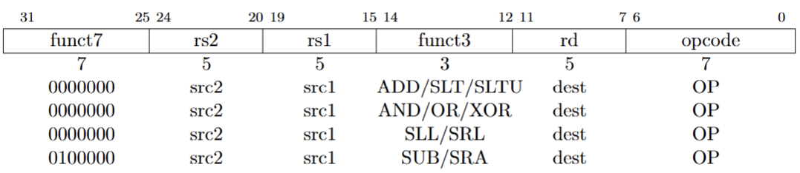
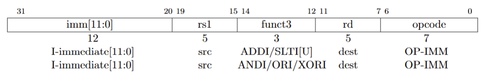
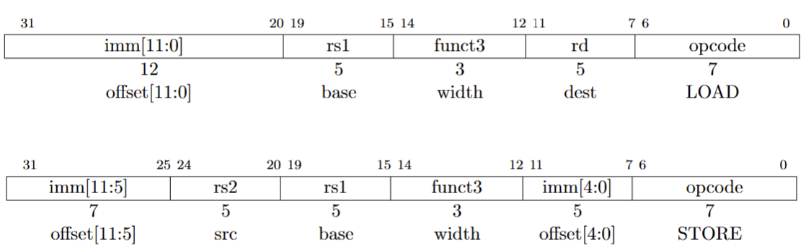
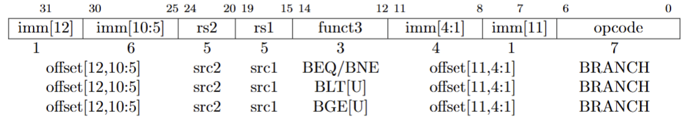
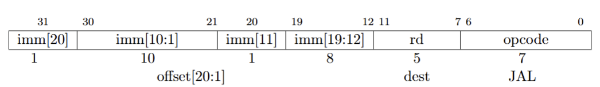
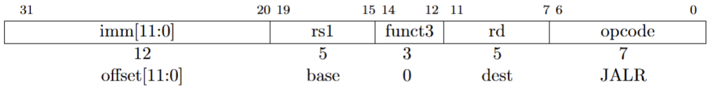
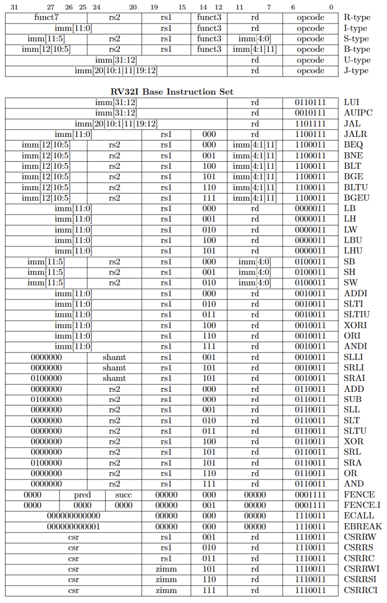

# RISC-V Simulator
**Name**: Karthikeyan Vetrivel  
**ID**: 515003924  
**Email**: vkarthikeyan@tulane.edu  

This project consists of 2 parts, Disassembler and Simulator.
Disassembler currently reads binary text and writes the decoded assembly instruction on each output line.

This project was run on WSL Ubuntu Linux.

**Assumptions:**  
This submission covers Part I: Disassembler.  
Output formatting follows fibonacci_out_rv32.txt, including lowercase register names, spacing, and line endings. Addresses begin at 496 and increase by four bytes per word.  

## Instruction Format
The following list of Instructions had to be supported:
- `JAL`, `JALR`, `BEQ`, `BNE`, `BGE`, `BLT`
- `ADDI`
- `RET`  // `JALR x0, x1, 0`
- `SLT`
- `SW`, `LW`
- `SLL`, `SRL`
- `SUB`,  `ADD`
- `AND`, `OR`, `XOR`
- `SLTI`

The decoders in the disassemblers were written with reference to the following format, found in the "The RISC-V Instruction Set Manual".  

`rd` is the destination register.
`rs1` and `rs2` are source registers.
`imm` is the immediate value. 
`opcode`, `funct3`, and `funct7` identify the instruction.

---

### ADD, SUB, SLT, SLL, SRL, AND, OR, XOR - R-Type  


Implemented in [r_type.cpp](src/decoder/r_type.cpp) using `extractRTypeFields()`.

---

### ADDI, SLTI - I-type  



Implemented in [i_type.cpp](src/decoder/i_type.cpp) using `extractITypeFields()`. Assembly operands are `rd, rs1, immediate`. The immediate is a signed 12-bit value.

---

### LW, SW - I-type and S-type  


`LW` calls `extractITypeFields()` in [i_type.cpp](src/decoder/i_type.cpp), while `SW` calls `extractSTypeFields()` in [s_type.cpp](src/decoder/s_type.cpp). 

> **Note**: Stores have no destination register: `rs2` supplies the value to store.
---
### BEQ, BNE, BGE, BLT - B-type  


Implemented in [b_type.cpp](src/decoder/b_type.cpp) using `extractBTypeFields()`.

---

### JAL - J-type  



Implemented by `decodeJal()` in [j_type.cpp](src/decoder/j_type.cpp), using `extractJTypeFields()`. 

---

### JALR, RET - I-type  



Implemented by `decodeJalr()` in [i_type.cpp](src/decoder/i_type.cpp), using `extractITypeFields()`.
> Note: The program prints `RET` for `JALR x0, x1, 0`. Words after `RET` are displayed as signed 32-bit integers.

---

### Complete Encoding Reference  


## Project Structure
```text
RISC-Vsim/
├── CMakeLists.txt
├── README.md
├── include/
│   └── riscv/
│       └── decoder.h
├── src/
│   ├── main.cpp
│   └── decoder/
│       ├── decoder.cpp
│       ├── r_type.cpp
│       ├── i_type.cpp
│       ├── s_type.cpp
│       ├── b_type.cpp
│       └── j_type.cpp
├── struct_images/
└── proj_files/
```

`main.cpp` handles the input and output.  
`decoder.cpp` dispatches by opcode, and each format file implements its instruction decoders.  
`decoder.h` declares the public decoder functions.  
`decoder/` holds the specific decoder functions for the different commands in the instruction set.  

## Build and Run

```bash
cd /home/vetri/RISC_Vsim

cmake -S . -B build
cmake --build build

# Part 1
./build/RISC-Vsim proj_files/part1/sample_input.txt part1_check.txt dis
diff proj_files/part1/sample_output.txt part1_check.txt

# Part 2
./build/RISC-Vsim proj_files/part1/fibonacci_input.txt part2_check.txt sim -T 0:40
diff proj_files/part2/sample-out2.txt part2_check.txt
```

## References

Waterman, A., & Asanović, K. (Eds.). (2017). *The RISC-V instruction set manual: Volume I: User-level ISA* (Document version 2.2). RISC-V Foundation. https://content.riscv.org/wp-content/uploads/2017/05/riscv-spec-v2.2.pdf
